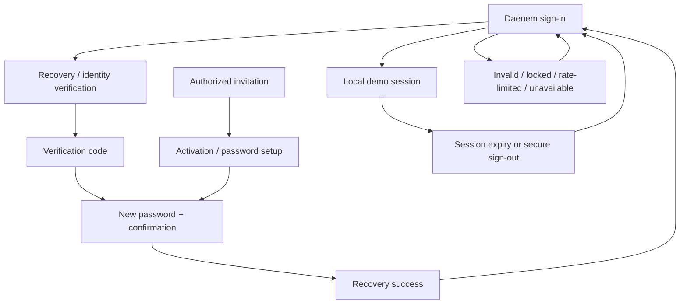

# Daenem Staff Portal — Experience build checkpoint

This is a private design-lab implementation built from the supplied 58-section contract. It is **not accepted, independently graded, or certified at 99%**. The previous cycle remains available at `/review/cycle-1`.

## Current status

`STAFFPORTAL_SITES_BUILD_CHECKPOINT_BROWSER_QA_BLOCKED`

- Primary workspaces registered: **72**.
- Additional surfaces: `/signin`, each supported record at `/workspace-id/record-id`, and the prior review study.
- Source contract checks: **28/28 PASS**.
- TypeScript and framework build: see final validation report; passing source checks do not prove visual quality.
- Browser / screenshot / responsive verification: **NOT RUN**. Cloud Browser rejected the internal local preview URL under its URL access policy. No alternate browser or host was used to bypass it.
- Independent owner review: **PENDING**.
- Daenem production deployment, GitHub writes, production D1 writes, production Cloudflare changes: **NONE**.
- Authentication model: **Daenem-owned authentication represented by an explicitly local demo session**. Platform access to the private Site is separate from the simulated application's business authentication.

## 1. Private interactive Site

The existing `DAENEM STAFF PORTAL — PREMIUM EXPERIENCE LAB` is reused. The final response provides a private URL only if native Sites publication succeeds. No production Daenem domain is connected.

At sign-in, expand **DEVELOPMENT PREVIEW ONLY**, choose Owner / Manager / Employee, and choose **Fill demo credentials**. The credentials are fictional and never transmitted or stored. Authentication error states can be selected in that same reviewer control. After signing in, the development strip opens role, company and data-state controls.

## 2. Route inventory

See `route-inventory.csv` for every workspace, exact Site route, ERP family, purpose, primary user, primary action, archetype and source status. Routing uses one React path dispatcher; a registered route is not a claim of browser QA or full feature acceptance.

## 3. Feature coverage

See `feature-coverage.csv` for **1092 individual bullet requirements** extracted from the supplied brief. The matrix is intentionally conservative. A literal source representation is marked separately from a partial or unverified requirement. No feature is marked browser-tested without evidence.

## 4. Authentication flow map



The state selector also exposes temporary password expiry, required replacement, mismatched confirmation, invalid/expired codes, location permission, geofence restriction, offline state and profile onboarding. There is no public employee registration. No actual passwords are changed. A local password challenge gates bank-detail reveal, permission-override application and recovery issuance; it includes mismatch feedback, cancel and verified continuation. It uses the fictional password DEMO-CONFIRM, never a production credential. Several invitation/activation edge cases remain state representations rather than an end-to-end lifecycle.

## 5. Role and permission matrix

| Context | Home | Navigation / records | Actions |
|---|---|---|---|
| Owner | Group command with business and exception drill-downs | All role-permitted companies; selectable company; explicit No Access override removes data and search targets | Authorized simulated management and review; maker-checker applies |
| Manager | Team and exception-oriented cockpit | Assigned company and permitted management workspaces; no Owner-only finance/security/access | Scoped simulated management and approvals |
| Employee | Own day, attendance, tasks and self-service | Own permitted records, no workforce aggregates or restricted admin registry | Own permitted creation/edits; no approvals or payslip edits |

Source checks verify company and employee filtering, View/Create/Edit distinctions, No Access, read-only historical workshop records and maker-checker restrictions. This is **frontend demo authorization, not production security certification**.

## 6. Page archetypes

See `page-archetypes.csv`. Printing uses stage lanes; Bakery uses batch tracks and yield reconciliation; Autos uses inventory selection and sales economics; Logistics combines schematic routes and dispatch; Properties uses unit occupancy; Finance uses a reconciliation ribbon and ledger; Payroll uses readiness gates; Profile uses identity and self-service sections; Security uses an investigative event stream. Shared record tables and forms are used for suitable supporting pages.

## 7. Visualization inventory

See `visualization-inventory.csv`. Implemented chart primitives include area, line, grouped bars, donut support, scatter/bubble, proportional bars, a waterfall, treemap, funnel, calendar heatmap, unit matrix, Gantt-style timeline and route schematic. Charts use fictional datasets. Finance period totals, the plotted series and the cash bridge now derive from one selected-period fixture. Other domain metrics still require a dedicated coherence review. Some domain summaries remain illustrative independent fixtures and need coherence review against editable records.

## 8. Responsive evidence

See `responsive-evidence.csv`: nine required screen classes by seven required viewport sizes. **Every browser evidence cell is explicitly NOT RUN**. No screenshots, metrics, pixel-fidelity grade, contrast audit or overflow pass is fabricated. Responsive CSS includes mobile drawers, mobile record cards, stacked master–detail, media queries for tablet, desktop and 4K, and larger rem-based type at wide resolutions. These declarations still require visual QA.

## 9. State coverage

See `state-coverage.csv`. Loading, empty, error, offline, stale, permission denied, no results, success, warning, conflict and unavailable integration are represented. Offline and conflict behavior are simulations with device-local storage, not the production synchronization engine.

## 10. Design system

- Direction: dark green organizational navigation, clear white working surfaces, restrained botanical accents, purpose-specific domain color, crisp typographic hierarchy and a photographic sign-in.
- Type: Bundled Inter Variable for body/UI and Manrope Variable for display text, licensed under SIL OFL 1.1; system fallback remains available while loading. Main type uses rem units; the new experience stylesheet has no authored font-size below 0.75rem at a 16px root.
- Spacing: 0.25 / 0.5 / 0.75 / 1 / 1.25 / 1.5 / 2rem; comfortable, standard and compact density adjust panel/table rhythm.
- Surfaces: solid operational surfaces; translucency reserved for sign-in; 7–12px interface radii and restrained shadows.
- Status: text accompanies semantic color; required / review / incomplete uses amber, approved / present uses green, failures use red.
- Icons: Lucide SVGs and an authored vector DAENEM monogram.
- Charts: visible units and Demo Data labels; tooltips and drill-downs where implemented. No schematic geography is called live GPS.
- Responsive: primary shifts around 767, 1024, 1250/1400, 2200, 2560 and 3200px. 390px uses single-column records and drawers. Seven-size validation remains blocked.
- Motion: Off / Calm / Balanced / Expressive plus `prefers-reduced-motion`; no strobing.
- Accessibility: semantic controls, labels, skip link, focus styling, Radix dialogs/sheets/tabs/select and command palette. Actual keyboard, touch, zoom and contrast testing remains outstanding.
- Layout: ten distinct home compositions. `resolveLayout` implements forced organization → permitted personal → role → ERP → organization → Executive fallback. Domain workspaces retain their functional architecture. Independent selection of theme, layout, density, motion and navigation is represented.

## 11. Assets

See `asset-manifest.csv`. The sign-in source is **1672×941**, not a native 4K image. It has not been falsely relabelled or upscaled as native 4K. A suitable higher-resolution replacement is required before accepting the 4K image requirement. No externally sourced factual employee photos or production location images are claimed.

## 12. Data / API adapter map

See `adapter-map.csv`. All major modules use fixture data and local simulations. The `ProductionAdapter` interface describes listing and mutation boundaries but is not connected. Every unknown production contract is explicitly marked **PRODUCTION CONTRACT TO BE MAPPED DURING INTEGRATION**. No invented production endpoints, tokens, D1 schema or banking integration are supplied.

## 13. Component inventory

- Shell: Portal, Logo, authorized navigation, company context, development simulator, command palette, global action/help sheets, sign-out dialog.
- Primitives: Btn, IconBtn, Pick, Badge, Avatar, Panel, Empty, Callout, Steps, Timeline, RecordsTable, DownloadCSV.
- Records: RecordEditor, RecordDetail, LocalEvidence viewer for device-local PDF/image/text attachments, local record mutation and history; profile document reader and explicit policy acknowledgement.
- Charts: lazy-loaded Recharts implementation, Viz, Bars, RouteMap, Weather, timeline/matrix/domain compositions.
- Experiences: Homes (ten structural variants and role homes), Profile (ten self-service sections), Attendance, Calendar, People, Payroll, Payslips, Board, Bakery, Autos, Logistics, Properties, Finance, Approvals, Operations, StaffWork, Communications, Audit, Studio, Access, Policy, Integrations, Sync, Recovery, Support, Toolbox and Help.
- State: typed module registry, fixture records, permissions, mutation validation, device-local draft hooks and preferences.

## 14. Transfer notes

The Site uses React on the existing Vinext starter. Preserve production logic and map accepted frontend behavior through real Daenem adapters later. Recharts and business workspaces are lazy-loaded; Inter and Manrope font files and their license notices are bundled; Lucide provides icons; installed Radix/Shadcn primitives provide interaction semantics. The historical cycle-1 page and styles are preserved for comparison.

Records are local demo objects. Expense approval and employee expense views share the same request objects. Only submitted requests enter the pending decision queue; request makers cannot decide their own requests. Global search and counts use the same authorized record union as the workspace views. Returned requests can be corrected and resubmitted. Required material usage, yield, POD and receipts gate completion. Payroll values and statutory configuration are illustrative; no real statutory calculation or payment is performed. Attendance requires separate explicit clock-in and clock-out. Profile, selected draft composers and preference history use local storage. Device data is not cross-device durable and is not a substitute for the existing offline engine.

Transfer only owner-accepted designs. Do not transfer the role simulator, fake credentials, simulated consent, fixture telemetry, synthetic chart values or browser-review controls into production.

## 15. Known gaps

| Class | Gap | Consequence |
|---|---|---|
| RESPONSIVE / VISUAL / ACCESSIBILITY | Browser preview blocked by Cloud Browser URL policy | No responsive, screenshot, keyboard, contrast, zoom or motion QA can be claimed |
| VISUAL | Sign-in photo is native 1672×941 | Native crisp 4K image requirement remains unmet |
| INTERACTION | Secondary business processes use shared record forms; some detailed subflows are only represented conceptually | POS checkout, detailed stock transfers, supplier procurement, vehicle documentation, advanced table bulk/column tools, and full recruitment/HR lifecycle handoffs require deeper completion and review |
| INTERACTION | Record attachments have local PDF/image/text previews up to 2 MB; profile documents use readable fictional content | Production upload lifecycle, malware inspection, retention and real HR document integration remain unmapped |
| INTERACTION | Local reauthentication is implemented for selected sensitive actions; activation and invitation edge cases remain partial | Full provisioned-employee lifecycle and production identity integration require further review |
| INTERACTION | Ten layout selections change home composition; specialized ERP pages retain their own architecture | Ten complete compositions for every business workspace are not implemented |
| DATA | Some chart summaries and workflow demos are independent fixtures | All KPI-to-record relationships require a dedicated coherence review |
| DATA / SITE-RUNTIME | Device-local drafts and simulated sync only | No installable offline PWA, service worker, true conflict merge, continuous GPS or background tracking |
| INTEGRATION | Production APIs, identity, RBAC, payroll, provider telemetry and storage are disconnected | Intentional design-lab boundary; real contracts must be mapped later |
| PERFORMANCE | Source code splitting is implemented; no browser performance measurements | Interaction performance and high-density 4K rendering are ungraded |
| OTHER | Owner and independent reviewer have not inspected this checkpoint | This is not final acceptance or 99% certification |

## 16. Final status

```text
SITES_BUILD_STATUS:
STAFFPORTAL_SITES_BUILD_CHECKPOINT_BROWSER_QA_BLOCKED

PRODUCTION DEPLOYED: NO (Daenem production)
GITHUB MODIFIED: NO
PRODUCTION D1 WRITTEN: NO
PRODUCTION CLOUDFLARE MODIFIED: NO
AUTH MODEL: DAENEM OWN AUTHENTICATION REPRESENTED
PRIMARY WORKSPACES REGISTERED: 72
READY FOR INDEPENDENT CHATGPT REVIEW: PARTIAL CHECKPOINT ONLY
FULL EXPERIENCE READY STATUS: NOT CLAIMED
```

The full requested ready status must not be issued until the above gaps and the required review are closed.
