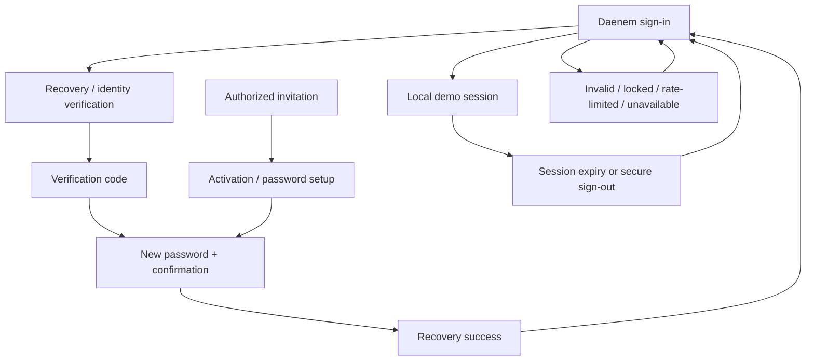

# Authentication flow

The state selector also exposes temporary password expiry, required replacement, mismatched confirmation, invalid/expired codes, location permission, geofence restriction, offline state and profile onboarding. There is no public employee registration. No actual passwords are changed. A local password challenge gates bank-detail reveal, permission-override application and recovery issuance; it includes mismatch feedback, cancel and verified continuation. It uses the fictional password DEMO-CONFIRM, never a production credential. Several invitation/activation edge cases remain state representations rather than an end-to-end lifecycle.